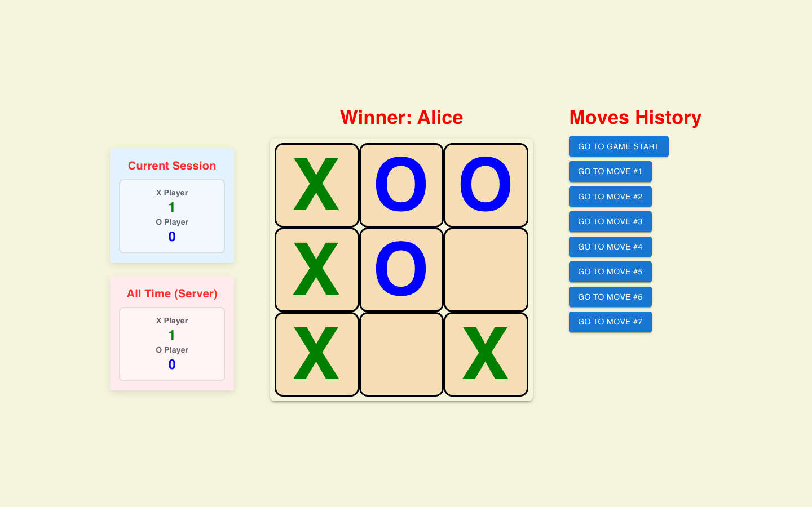
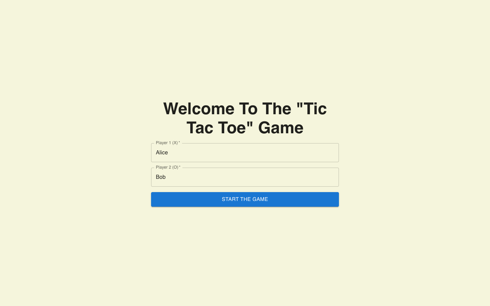
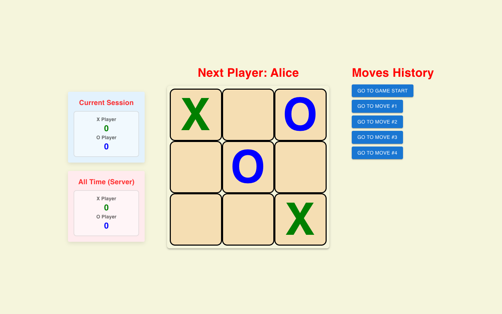
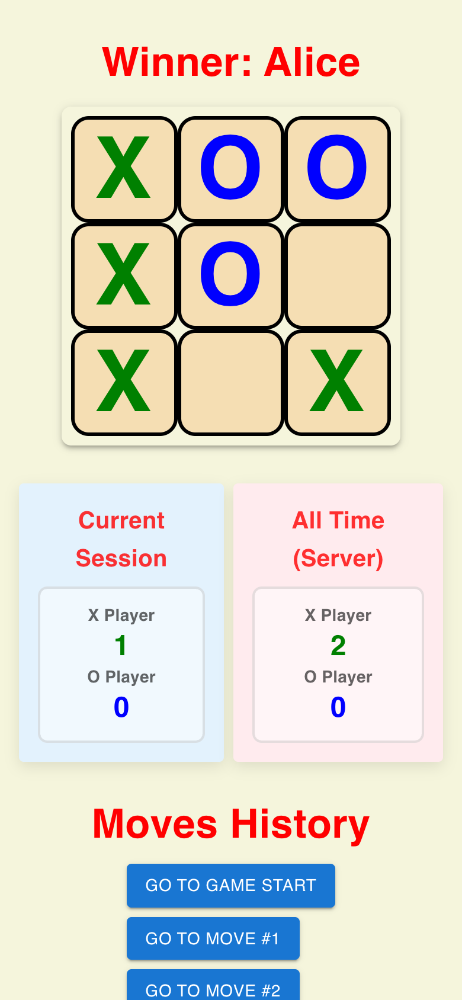
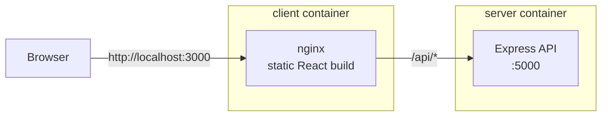

# Tic-Tac-Toe

[](https://github.com/JonHadar/Tic-Tac-Toe-Game/actions/workflows/ci.yml)

A full-stack, two-player Tic-Tac-Toe game: a React + TypeScript client with Material UI, and an Express API that keeps all-time win statistics. It ships as two production Docker images behind nginx and is tested and smoke-tested on every push with GitHub Actions.

<p align="center">
  
</p>

## Features

- **Two players** enter their names and take turns as X and O.
- **Move history:** jump back to any earlier move and continue from there.
- **Two score boards:** wins in the current session, and all-time wins stored on the server and shared by every player.
- **Responsive layout** for desktop and mobile.

| Start screen | Game in progress | Mobile |
|---|---|---|
|  |  |  |

## Tech stack

| Area | Tools |
|---|---|
| Client | React 19, TypeScript, Material UI, Vite |
| Server | Node.js, Express 5, TypeScript |
| Testing | Vitest, React Testing Library, Supertest |
| Containers | Docker multi-stage builds, nginx, Docker Compose |
| CI | GitHub Actions |

## Architecture



The browser only talks to nginx. nginx serves the built React app and forwards every `/api` request to the Express container, so the client never needs to know the server's address. In development, Vite's dev server does the same forwarding.

### API

| Method | Path | Description |
|---|---|---|
| `GET` | `/api/health` | Health check used by Docker and CI |
| `GET` | `/api/stats` | All-time wins, e.g. `{ "X": 3, "O": 1 }` |
| `POST` | `/api/win` | Record a win. Body: `{ "winner": "X" }` or `{ "winner": "O" }`; anything else returns `400` |

Statistics are kept in memory, so they reset when the server restarts.

## Run with Docker

Requires Docker with Compose.

```bash
docker compose up --build
```

Open http://localhost:3000. To use another port: `CLIENT_PORT=8080 docker compose up --build`.

### Or run the published images

Every merge to `main` publishes both images to GitHub Container Registry, so you can run the app without building anything:

```bash
docker compose pull
docker compose up --no-build
```

To run a specific release instead of `latest`: `TAG=1.0.0 docker compose up --no-build`.

| Image | Tags |
|---|---|
| `ghcr.io/jonhadar/tic-tac-toe-server` | `latest`, `sha-<commit>`, `<version>` |
| `ghcr.io/jonhadar/tic-tac-toe-client` | `latest`, `sha-<commit>`, `<version>` |

## Run locally for development

Requires Node.js 22 or newer. Use two terminals:

```bash
# Terminal 1: API on http://localhost:5000, restarts on changes
cd server
npm install
npm run dev
```

```bash
# Terminal 2: client on http://localhost:3000, updates on save
cd client
npm install
npm run dev
```

## Tests and checks

```bash
cd server && npm run typecheck && npm test
cd client && npm run lint && npm test && npm run build
```

- **Server:** API tests for every endpoint, including invalid input.
- **Client:** unit tests for the win and draw logic, and component tests that play full games: turns, wins, draws, ignored clicks, and a check that replaying the move history never counts a win twice.

## CI/CD pipeline

Every push to `main`, every version tag and every pull request runs [`.github/workflows/ci.yml`](.github/workflows/ci.yml):

1. **Server:** install, type-check, test, build.
2. **Client:** install, lint, test, type-check and build.
3. **Docker:** once both pass, build both images, start the stack, wait for the health checks, then smoke-test the page and the API through nginx.
4. **Scan:** in parallel with step 3, build each image and scan it with Trivy (see [Security](#security)).
5. **Helm:** lint the chart and validate the rendered dev and prod manifests against the Kubernetes schemas with kubeconform.
6. **Kubernetes:** create a temporary [kind](https://kind.sigs.k8s.io) cluster, load freshly built images into it, install the chart with the dev values, wait for every Pod to be ready, and run `helm test`. On failure it prints Pod logs and cluster events.
7. **Publish** (pushes to `main` and version tags only): build both images with layer caching and push them to GitHub Container Registry, tagged `latest` and `sha-<commit>` on `main`, and `1.2.3` / `1.2` for a `v1.2.3` tag.
8. **Deploy to dev** (`main` only): commit the new `sha-<commit>` tag to `values-dev.yaml`; Argo CD then rolls dev forward (see [GitOps](#gitops-with-argo-cd)).

Publishing requires every check to pass. Pull requests run steps 1 to 6 only, so nothing is published until a change is merged.

## Kubernetes (Helm)

The [Helm chart](deploy/helm/tic-tac-toe) deploys the same two images to Kubernetes:

| Resource | Details |
|---|---|
| Server Deployment + Service | 1 replica (stats live in memory), probes on `/api/health`, non-root, read-only filesystem |
| Client Deployment + Service | nginx; `API_UPSTREAM` points it at the server Service |
| Ingress | optional, `ingress.enabled=true` |
| Helm test | a Pod that checks the page, the API and win recording through the client Service |

Environments are values files: [`values-dev.yaml`](deploy/helm/tic-tac-toe/values-dev.yaml) and [`values-prod.yaml`](deploy/helm/tic-tac-toe/values-prod.yaml) (pinned image, 2 client replicas, more resources). `image.tag` sets the tag of both images.

```bash
helm install tic-tac-toe deploy/helm/tic-tac-toe \
  -n tic-tac-toe --create-namespace \
  -f deploy/helm/tic-tac-toe/values-dev.yaml
helm test tic-tac-toe -n tic-tac-toe
kubectl -n tic-tac-toe port-forward svc/tic-tac-toe-client 3000:80
```

While the images are private, create a pull secret and pass it with `--set imagePullSecrets[0].name=ghcr-pull`:

```bash
kubectl -n tic-tac-toe create secret docker-registry ghcr-pull \
  --docker-server=ghcr.io --docker-username=<github-user> --docker-password=<token with read:packages>
```

## GitOps with Argo CD

An Argo CD [ApplicationSet](deploy/argocd/applicationset.yaml) deploys the chart to two environments: **dev** syncs automatically from `main` (with pruning and self-healing), and **prod** is synced by hand from a pinned image tag. After every merge, CI commits the new image tag to the dev values, so dev always runs the latest tested build; [`promote-to-prod.sh`](deploy/scripts/promote-to-prod.sh) opens a pull request that releases it to prod. [`deploy/scripts/local-argocd.sh`](deploy/scripts/local-argocd.sh) sets the whole thing up on a local kind cluster. See [deploy/README.md](deploy/README.md) for the flow, local setup and how to release to prod.

## Security

- **Image scanning:** every pipeline run scans both images with [Trivy](https://trivy.dev). High and critical findings are reported in the repository's **Security → Code scanning** tab (public repository only), and a critical vulnerability that has a fix fails the pipeline, so such an image is never published.
- **Automatic updates:** [Dependabot](.github/dependabot.yml) opens weekly pull requests for npm packages, Docker base images and GitHub Actions; each one goes through the full pipeline before it can be merged.
- **Hardened images:** the server runs as a non-root user without npm in the runtime image, and both images apply Alpine security updates at build time.
- **Least privilege:** the workflow token is read-only by default; only the scan job can write security results and only the publish job can push images.

## Docker images

- **Server:** a build stage compiles TypeScript; the runtime stage contains only production dependencies and the compiled code, runs as a non-root user, and has a health check.
- **Client:** a build stage bundles the app with Vite; the runtime stage is nginx serving static files, with long-term caching for hashed assets.

## Project structure

```
.
├── client/                 React app
│   ├── src/
│   │   ├── Game.tsx        Game state, move history, score keeping
│   │   ├── Board.tsx       Status line, score boards and grid
│   │   ├── gameLogic.ts    Winner and draw detection
│   │   ├── api.ts          Calls to the Express API
│   │   └── *.test.ts(x)    Tests
│   ├── templates/          nginx config: static files + /api proxy
│   └── Dockerfile
├── server/                 Express API
│   ├── src/app.ts          Routes
│   ├── src/server.ts       Entry point
│   ├── test/               API tests
│   └── Dockerfile
├── deploy/
│   ├── helm/tic-tac-toe/   Helm chart (dev and prod values)
│   ├── argocd/             Argo CD ApplicationSet
│   └── scripts/            Local kind + Argo CD setup
├── docker-compose.yml
└── .github/workflows/ci.yml
```

## Author

Jonathan Hadar ([@JonHadar](https://github.com/JonHadar)) · [Portfolio](https://jonathan-hadar.vercel.app)
