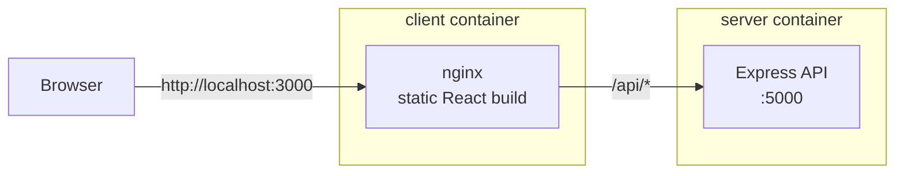

# Tic-Tac-Toe

[](https://github.com/JonHadar/Tic-Tac-Toe-Game---TypeScript-MUI-Express/actions/workflows/ci.yml)

A full-stack, two-player Tic-Tac-Toe game: a React + TypeScript client with Material UI, and an Express API that keeps all-time win statistics. It ships as two production Docker images behind nginx and is tested and smoke-tested on every push with GitHub Actions.

<p align="center">
  
</p>

## Features

- **Two players** enter their names and take turns as X and O.
- **Move history:** jump back to any earlier move and continue from there.
- **Two score boards:** wins in the current session, and all-time wins stored on the server and shared by every player.
- **Responsive layout** for desktop and mobile.

| Start screen | Game in progress | Mobile |
|---|---|---|
|  |  |  |

## Tech stack

| Area | Tools |
|---|---|
| Client | React 19, TypeScript, Material UI, Vite |
| Server | Node.js, Express 5, TypeScript |
| Testing | Vitest, React Testing Library, Supertest |
| Containers | Docker multi-stage builds, nginx, Docker Compose |
| CI | GitHub Actions |

## Architecture



The browser only talks to nginx. nginx serves the built React app and forwards every `/api` request to the Express container, so the client never needs to know the server's address. In development, Vite's dev server does the same forwarding.

### API

| Method | Path | Description |
|---|---|---|
| `GET` | `/api/health` | Health check used by Docker and CI |
| `GET` | `/api/stats` | All-time wins, e.g. `{ "X": 3, "O": 1 }` |
| `POST` | `/api/win` | Record a win. Body: `{ "winner": "X" }` or `{ "winner": "O" }`; anything else returns `400` |

Statistics are kept in memory, so they reset when the server restarts.

## Run with Docker

Requires Docker with Compose.

```bash
docker compose up --build
```

Open http://localhost:3000. To use another port: `CLIENT_PORT=8080 docker compose up --build`.

## Run locally for development

Requires Node.js 22 or newer. Use two terminals:

```bash
# Terminal 1: API on http://localhost:5000, restarts on changes
cd server
npm install
npm run dev
```

```bash
# Terminal 2: client on http://localhost:3000, updates on save
cd client
npm install
npm run dev
```

## Tests and checks

```bash
cd server && npm run typecheck && npm test
cd client && npm run lint && npm test && npm run build
```

- **Server:** API tests for every endpoint, including invalid input.
- **Client:** unit tests for the win and draw logic, and component tests that play full games: turns, wins, draws, ignored clicks, and a check that replaying the move history never counts a win twice.

## CI/CD pipeline

Every push to `main` and every pull request runs [`.github/workflows/ci.yml`](.github/workflows/ci.yml):

1. **Server:** install, type-check, test, build.
2. **Client:** install, lint, test, type-check and build.
3. **Docker:** once both pass, build both images, start the stack, wait for the health checks, then smoke-test the page and the API through nginx.

## Docker images

- **Server:** a build stage compiles TypeScript; the runtime stage contains only production dependencies and the compiled code, runs as a non-root user, and has a health check.
- **Client:** a build stage bundles the app with Vite; the runtime stage is nginx serving static files, with long-term caching for hashed assets.

## Project structure

```
.
├── client/                 React app
│   ├── src/
│   │   ├── Game.tsx        Game state, move history, score keeping
│   │   ├── Board.tsx       Status line, score boards and grid
│   │   ├── gameLogic.ts    Winner and draw detection
│   │   ├── api.ts          Calls to the Express API
│   │   └── *.test.ts(x)    Tests
│   ├── nginx.conf          Static files + /api proxy
│   └── Dockerfile
├── server/                 Express API
│   ├── src/app.ts          Routes
│   ├── src/server.ts       Entry point
│   ├── test/               API tests
│   └── Dockerfile
├── docker-compose.yml
└── .github/workflows/ci.yml
```
