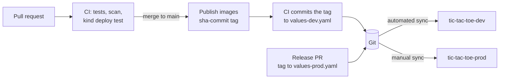

# Deployment

How Tic-Tac-Toe gets from a commit to running environments.



Every running version is a commit: dev and prod run exactly the image tags written in their values files.

## Layout

| Path | What it is |
|---|---|
| [`helm/tic-tac-toe/`](helm/tic-tac-toe) | Helm chart for the client and the server |
| [`helm/tic-tac-toe/values-dev.yaml`](helm/tic-tac-toe/values-dev.yaml) | dev environment |
| [`helm/tic-tac-toe/values-prod.yaml`](helm/tic-tac-toe/values-prod.yaml) | prod environment: pinned image tag, 2 client replicas |
| [`argocd/applicationset.yaml`](argocd/applicationset.yaml) | Argo CD ApplicationSet that creates one Application per environment |
| [`scripts/local-argocd.sh`](scripts/local-argocd.sh) | Runs the whole setup on a local kind cluster |
| [`scripts/promote-to-prod.sh`](scripts/promote-to-prod.sh) | Opens a pull request that releases the dev image to prod |

## GitOps with Argo CD

Git is the source of truth: Argo CD continuously compares what is in the repository with what runs in the cluster.

- **One ApplicationSet, two Applications.** A list generator creates `tic-tac-toe-dev` and `tic-tac-toe-prod`, each deploying the chart into its own namespace with its own values file.
- **dev** has automated sync with `prune` and `selfHeal`: every change on `main` is applied, removed resources are deleted, and manual changes in the cluster are reverted.
- **prod** syncs only when someone presses Sync, so releases are deliberate.
- The difference is a single `autoSync` flag per environment, applied through the ApplicationSet's `templatePatch`.

## Run it locally

Requires Docker, [kind](https://kind.sigs.k8s.io), kubectl and Helm.

```bash
./deploy/scripts/local-argocd.sh
```

The script creates a kind cluster, installs Argo CD with its Helm chart, and applies the ApplicationSet. While the repository and images are private, pass credentials:

```bash
GITHUB_TOKEN=<token with read access to the repo> \
GHCR_TOKEN=<token with read:packages> \
./deploy/scripts/local-argocd.sh
```

| Variable | Purpose | Default |
|---|---|---|
| `CLUSTER` | kind cluster name | `tic-tac-toe` |
| `REVISION` | branch or tag Argo CD follows | `main` |
| `REPO_URL` | repository Argo CD reads (e.g. a fork) | this repository |
| `GITHUB_TOKEN` | repository credentials for Argo CD | none |
| `GHCR_TOKEN` / `GHCR_USER` | image pull secret `ghcr-pull` in both namespaces | none / `JonHadar` |

Open the Argo CD UI:

```bash
kubectl -n argocd port-forward svc/argocd-server 8080:80
# http://localhost:8080, user admin, password:
kubectl -n argocd get secret argocd-initial-admin-secret -o jsonpath='{.data.password}' | base64 -d
```

Play the dev environment:

```bash
kubectl -n tic-tac-toe-dev port-forward svc/tic-tac-toe-client 3000:80
```

Remove everything: `kind delete cluster --name tic-tac-toe`.

## From commit to production

1. **Merge to `main`.** CI tests the change, deploys it to a temporary cluster, scans it, and publishes the images tagged `sha-<commit>`.
2. **dev updates itself.** The `promote-dev` CI job writes the new tag into `values-dev.yaml` and commits it to `main` (as `github-actions[bot]`). Argo CD sees the commit and rolls dev forward. Commits pushed with the workflow's own token don't start new pipeline runs, so this can't loop.
3. **Release to prod.** When dev looks good, run:

   ```bash
   ./deploy/scripts/promote-to-prod.sh
   ```

   It opens a pull request that copies the dev tag into `values-prod.yaml`, so every release is reviewed and recorded in Git.
4. **Merge and sync.** After the pull request is merged, sync `tic-tac-toe-prod` in Argo CD.

Rolling back is the same flow in reverse: revert the commit that changed the tag.

Why tags instead of `latest`: Argo CD deploys what the manifests say. If the tag never changes, the manifests never change, and a new image would never be rolled out. An immutable tag per commit makes every deployment visible, reviewable and reversible in Git.
